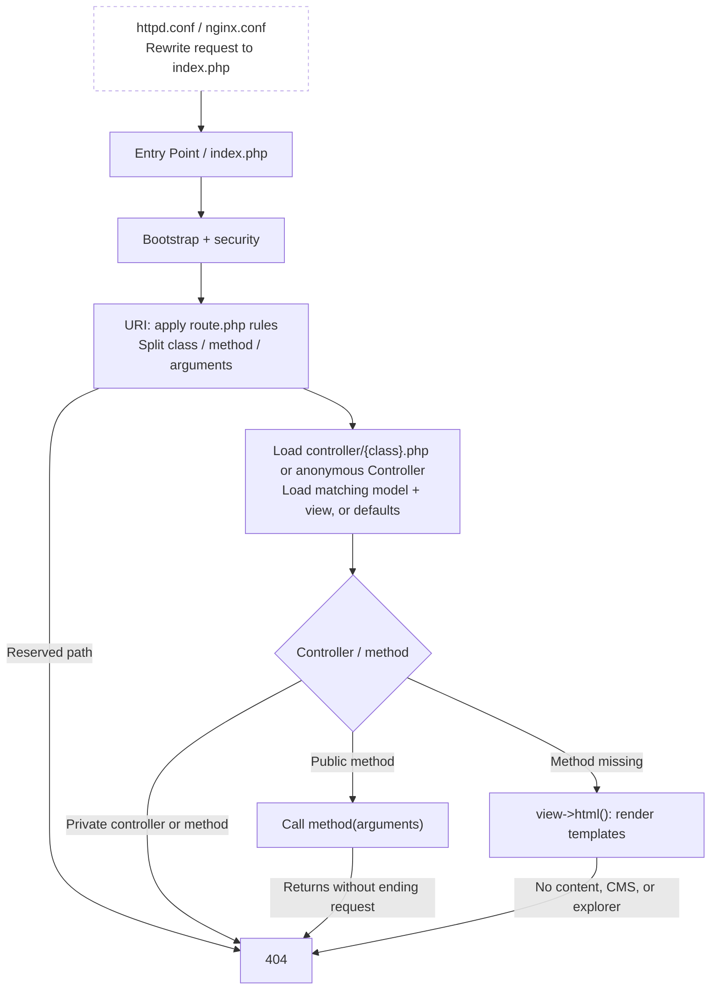

# Cenari Management System

## Synopsis
A content management system.

## Installation
Prerequisites:
* MySQL Server (mariadb)
* PHP 7+
* PHP - php_mbstring
* PHP - php_pdo_mysql
* PHP - php_sockets
* Web Server (apache|nginx)

## Design

## Routing

`$uri->path` keeps the original path; `$uri->route` holds the rewritten path.

### Examples

All requests enter through `index.php`; these show what happens after routing.

| Scenario | Request → handler → result |
| --- | --- |
| Home page | `/` → `/index` → anonymous `Controller` → `Index_view` → `template/content/index.php` |
| Template without a controller | `/about` → anonymous `Controller` + default `View` → `template/content/about.php` |
| Wildcard rewrite | `/forum/topic` → `/construction` → anonymous `Controller` → `template/content/construction.php` |
| Controller, no method requested | `/upload` → `Upload` loads `Upload_model` + `Upload_view` → `template/content/upload.php` |
| Public method + arguments | `/upload/public/123/photo.jpg` → `$upload->public(['123', 'photo.jpg'])` → file response if found, otherwise 404 |
| Wildcard captures + method | `/profile/alice/upload/123/photo.jpg` → `/upload/private/123/photo.jpg` → `$upload->private(['123', 'photo.jpg'])` → ownership check, then file response |
| Response from a constructor | `/asset/image/captcha.png` → `/captcha` → `Captcha` constructor generates a PNG and ends the request |
| Reserved path | `/model/user` → blocked before controller loading → 404 |
| Private controller | `/user/status` → `User` extends `_Controller` → URL method call blocked → 404 |
| Private method | `/upload/cleanup` → `Upload` → `cleanup()` is private → URL method call blocked → 404 |
| Missing page | `/missing-page` → anonymous `Controller` → no content, CMS, or explorer → 404 |

Methods receive one argument: a string for one trailing segment, or an array for
several. A method that returns without ending the response reaches `index.php`'s
final 404 fallback; `view->html()` and `View::file()` both render and end the request.

## License
This is free and unencumbered software released into the public domain. For more
information, please refer to <https://unlicense.org> or the accompanying
UNLICENSE file.
